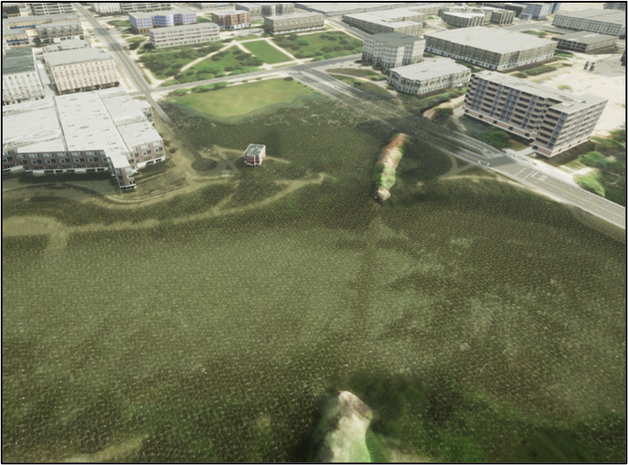
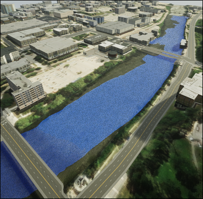
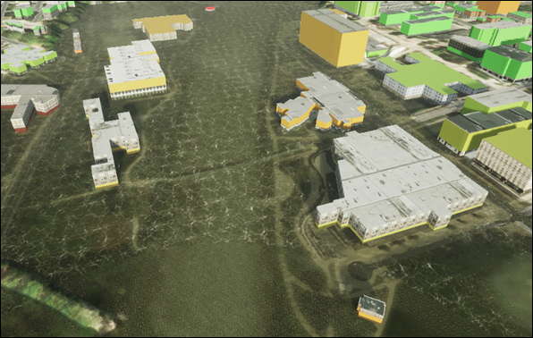
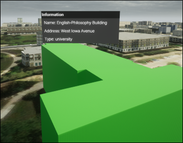
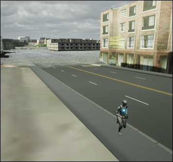
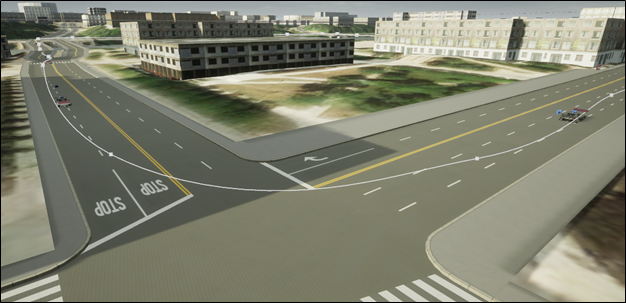

# VR-Flood-Sandbox: Immersive Virtual Reality Platform for Real-Time Flood Simulation and Analysis

[](LICENSE)
[](https://www.unrealengine.com/)
[](https://www.meta.com/quest/)

An immersive VR application for visualizing real-time flood simulations in urban environments. Built with Unreal Engine 5.3 and optimized for Meta Quest headsets, featuring AI-powered flood analysis and geospatial data integration.

---

## Table of Contents
- [Overview](#overview)
- [Features](#features)
- [Screenshots](#screenshots)
- [Requirements](#requirements)
- [Getting Started](#getting-started)
- [Configuration](#configuration)
- [Project Structure](#project-structure)
- [Core Components](#core-components)
- [Supported Platforms](#supported-platforms)
- [Dependencies](#dependencies)
- [Development](#development)
- [Contributing](#contributing)
- [License](#license)
- [Acknowledgements](#acknowledgements)

---

## Overview
VR-Flood-Sandbox is an Unreal Engine 5.3 project that provides an immersive virtual reality experience for flood simulation and visualization. The platform enables users to:
- Explore realistic 3D recreations of urban environments (e.g., Iowa City)
- Visualize real-time fluid dynamics and flood propagation
- Interact with flood scenarios using VR controllers
- Analyze flood impacts with AI-powered insights via OpenAI GPT-4

---

## Features
- **Immersive VR Experience** – Full VR support with hand tracking and eye tracking via OpenXR
- **Real-Time Fluid Simulation** – Dynamic water rendering using FluidFlux integration
- **GeoJSON Flood Maps** – Load and visualize flood extent data from geospatial sources
- **AI-Powered Analysis** – Screenshot capture with GPT-4 Vision integration for flood mitigation recommendations
- **Dynamic Weather** – SkyCreator plugin for realistic atmospheric conditions
- **Vehicle Simulation** – Chaos Vehicles plugin for flood evacuation scenarios
- **Cross-Platform** – Deploy to Meta Quest, Windows VR, and desktop

---

## Screenshots

### Flood Simulation


### Flood Map Visualization


### Building Damage Information


### 3D Models & Textures


### Humanoid NPCs


### Vehicle Spline Navigation


---

## Requirements

### Hardware
- **VR Headset**: Meta Quest 2/3/Pro (standalone or PC VR)
- **PC (for development)**: Windows 10/11, 16GB+ RAM, RTX 2070+ GPU

### Software
- [Unreal Engine 5.3](https://www.unrealengine.com/)
- [Visual Studio 2022](https://visualstudio.microsoft.com/) with C++ game development workload
- [Android Studio](https://developer.android.com/studio) (for Quest deployment)

---

## Getting Started

### 1. Clone the Repository
```bash
git clone https://github.com/uihilab/VR-Flood-Sandbox.git
cd VR-Flood-Sandbox
```

### 2. Open the Project
1. Launch Unreal Engine 5.3
2. Open `VR_VIS.uproject`
3. Allow shader compilation to complete

### 3. Configure API Keys
Before using AI analysis features, add your OpenAI API key:
1. Open `Source/VR_VIS/DataAnalysis.cpp`
2. Replace `YOUR_OPENAI_API_KEY_HERE` with your actual API key
3. Rebuild the project

### 4. Run the Simulation
- **Editor**: Press Play in the Unreal Editor
- **VR Preview**: Use VR Preview mode with a connected headset
- **Quest Standalone**: Package for Android and deploy via Meta Quest Developer Hub

---

## Configuration

### OpenAI Integration
The project uses OpenAI's GPT-4 Vision API for flood analysis. To enable:
1. Obtain an API key from [OpenAI Platform](https://platform.openai.com/)
2. Update the key in `DataAnalysis.cpp`
3. The system captures screenshots and sends them for AI-powered flood mitigation recommendations

### Android/Quest Deployment
Configure signing in `Config/DefaultEngine.ini`:
```ini
[/Script/AndroidRuntimeSettings.AndroidRuntimeSettings]
KeyStore=UE.keystore
KeyAlias=DistroKey
KeyStorePassword=YOUR_PASSWORD
```

---

## Project Structure
```
VR-Flood-Sandbox/
├── Config/                 # Engine and platform configuration
├── Content/
│   ├── Assets/             # 3D models, materials, textures
│   ├── Blueprints/         # Blueprint classes and logic
│   ├── FluidFlux/          # Fluid simulation assets
│   ├── Levels/             # Map files (Iowa City, Config Screen)
│   ├── UI/                 # User interface widgets
│   ├── VFX/                # Visual effects
│   └── VRTemplate/         # VR interaction framework
├── Plugins/
│   ├── MetaXR/             # Meta Quest integration
│   └── MetaXRPlatform/     # Oculus platform services
├── Source/VR_VIS/          # C++ source code
│   ├── DataAnalysis.cpp    # AI screenshot analysis
│   ├── Floodmap.cpp        # GeoJSON flood visualization
│   ├── SimConfiguration.cpp # Simulation settings
│   └── PlayerChar.cpp      # VR player controller
└── VR_VIS.uproject         # Project file
```

---

## Core Components

### DataAnalysis
Captures in-game screenshots and sends them to OpenAI GPT-4 Vision for flood mitigation analysis.

### Floodmap
Loads GeoJSON polygon data and renders animated flood extents in the 3D environment.

### SimConfiguration
Manages simulation parameters including flood levels, weather conditions, and time of day.

### PlayerChar
VR player pawn with motion controller support, teleportation, and interaction capabilities.

---

## Supported Platforms
| Platform | Status |
|----------|--------|
| Windows (Desktop) | ✅ Supported |
| Windows (VR - SteamVR/OpenXR) | ✅ Supported |
| Meta Quest 2/3/Pro | ✅ Supported |
| Android | ✅ Supported |
| Linux | 🔧 Experimental |

---

## Dependencies
- [Unreal Engine 5.3](https://www.unrealengine.com/)
- [OpenXR](https://www.khronos.org/openxr/) – VR runtime
- [Meta XR SDK](https://developer.oculus.com/) – Quest integration
- [FluidFlux](https://www.unrealengine.com/marketplace) – Fluid simulation
- [SkyCreator](https://www.unrealengine.com/marketplace) – Dynamic weather
- [OpenAI API](https://platform.openai.com/) – AI analysis (optional)

---

## Development

### Building from Source
```bash
# Generate project files (Windows)
"C:\Program Files\Epic Games\UE_5.3\Engine\Build\BatchFiles\GenerateProjectFiles.bat" VR_VIS.uproject

# Open in Visual Studio
start VR_VIS.sln
```

### Packaging for Quest
1. File → Package Project → Android
2. Select ASTC texture compression
3. Deploy APK via `adb install` or Meta Quest Developer Hub

---

## Contributing
Contributions are welcome! Please open an issue or pull request. For major changes, please open an issue first to discuss what you would like to change.

---

## License
This project is licensed under the MIT License - see the [LICENSE](LICENSE) file for details.

---

## Acknowledgements
This project is developed by the Tulane's Hydroinformatics Lab: [https://hydroinformatics.tulane.edu/](https://hydroinformatics.tulane.edu/).

> Gonzalez, E., Sajja, R., Sermet, Y., & Demir, I. (2025). FloodSim Sandbox: An Immersive Interactive Simulation Framework for Urban Flood Risk Management.
